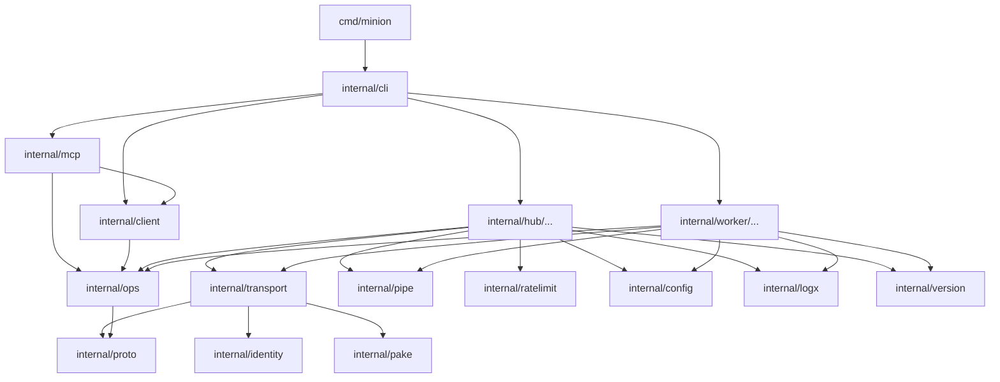
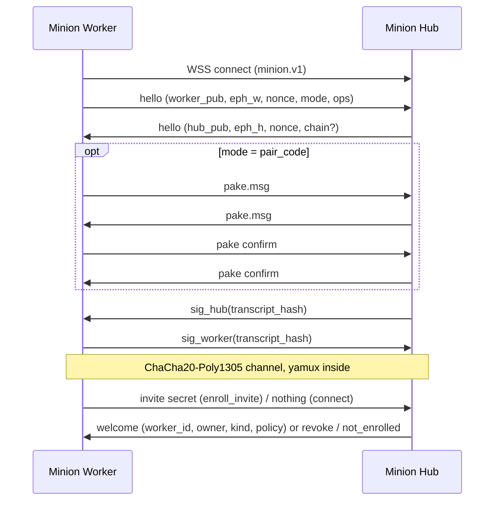
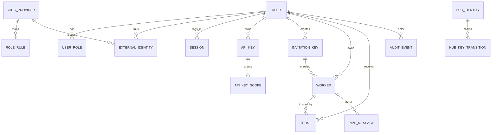
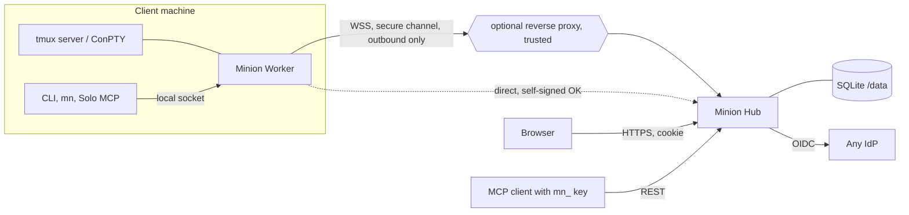

# Architecture Spine: AI Minion

**Minion Hub** is the central multi-user server with a web UI. **Minion Worker** is the client-side local proxy to tmux (ConPTY on Windows) on the machine that holds the sessions. Both are subcommands of one Go binary, `minion`, released under Apache-2.0. `mn` is a name for that same binary (a symlink or hardlink), not a second program. A Worker also runs alone, with no Hub, in **Solo** mode. Every product string is in English.

## Design Paradigm

Minion is a **modular monolith** with a **hexagonal core for each role**:

- **Domain packages** hold the rules and define the ports.
- **Adapters** implement those ports at the edge: tmux, ConPTY, SQLite, HTTP, WebSocket and OIDC.
- **The shared kernel** (`proto`, `ops`, `identity`) is the only contract shared by both roles. The Hub and the Worker meet only on the wire.



The edges in this diagram are the only dependency directions allowed. The rules:

- `hub/*` and `worker/*` never import each other.
- The kernel packages are `proto`, `ops`, `identity`, `pake`, `config`, `logx`, `version`, `ratelimit` and `pipe`. They import nothing else from `internal/`, with one exception: `ops` imports `proto`.

## Invariants & Rules

### AD-1: Module layout and library ownership

- **Binds:** all
- **Prevents:** overlapping packages, imports between Hub and Worker, and libraries spreading across packages.
- **Rule:**
  - The module path is `github.com/patrick-1984/ai-minion`. `cmd/minion` holds only `main`, and all other code lives in `internal/`.
  - Each library may be imported only by the packages listed here:

    | Library | Allowed importer |
    | --- | --- |
    | SQLite driver | `hub/store`, `worker/store` |
    | `tmux` executable | `worker/term/tmux`, plus `testutil/tmuxtest` for tests |
    | go-pty | `worker/term/conpty` |
    | yamux, websocket | `transport` |
    | go-oidc, oauth2 | `hub/auth/oidc` |
    | argon2 | `hub/auth/local` |
    | MCP SDK | `mcp` |
    | cobra | `cli` |
    | kardianos/service | `worker/service` |
    | sigstore-go | `version` |
    | Column encryption | `hub/store` (the `secretbox` file) |
  - All targets build with `CGO_ENABLED=0`.
  - Adding a top-level package under `internal/` requires a spine update.

### AD-2: One operation catalog

- **Binds:** REST API, Worker wire, MCP tools, CLI, web UI (R49, R27)
- **Prevents:** different surfaces naming, typing or permissioning the same action differently.
- **Rule:**
  - Each remote action is declared once in `internal/ops`. A declaration contains:
    - a snake_case name;
    - Go argument and result types, whose JSON encoding is the wire form;
    - the **accepted action set**, the alternatives any one of which suffices (for example `pipe_send: message|operate`);
    - the action-contract class of each guard (AD-15);
    - whether the action is a write, and whether it streams.
  - REST routes, wire op names, MCP tool names and CLI subcommands are all derived from the catalog.
  - Release-1 Worker ops: `sessions_list`, `session_create`, `session_snapshot`, `session_capture`, `send_text`, `send_keys`, `set_task`, `answer`, `pipe_send`, `pipe_read`, `pipe_wait`.
  - Release-1 Hub ops: accounts, roles, keys, invitations, workers (reassign, restrict, remove), trust, settings, audit read.
  - Error and reason codes are declared only in `internal/proto/codes.go`.

### AD-3: Worker-to-Hub transport

- **Binds:** `internal/transport`, `internal/proto`, the Hub and Worker connection code (R4, R17, R78)
- **Prevents:** incompatible framing, conflicting stream-ownership models, and a Hub that dials addresses supplied by a Worker.
- **Rule:**
  - **Connection setup.**
    - The Worker always dials out to `GET /api/v1/worker/connect` with WebSocket subprotocol `minion.v1` and binary messages. The Hub never dials a Worker.
    - The AD-6 handshake runs first, over raw handshake frames: a uint32 big-endian length (at most 64 KiB) followed by a JSON object.
    - Each later WebSocket message is one AEAD record of the secure channel. The record plaintexts form the byte stream that yamux runs on, wrapped through the coder/websocket `NetConn`. The Worker is the yamux client and the Hub is the yamux server.
  - **Stream kinds.** The first 2 bytes of each stream name its kind. The wire prefixes are exactly `op`, `ca` and `ev`, two ASCII bytes each; the 4-byte string `call` is never written. Byte-level framing tests are required for each kind.
    - `op`: opened by the Hub, one per request.
    - `ca` (the `call` kind): opened by the Worker, one per upstream request. Examples are `mn pipe_send` in Hub mode, a Worker-bound API key, and MCP on a Worker host.
    - `ev`: one long-lived event stream, opened by the Worker.
  - **Frames on streams.** Each frame is a uint32 big-endian length (at most 1 MiB) followed by one UTF-8 JSON object with a `type` field.
    - An `op` or `call` stream carries `op.request`, then zero or more `op.progress`, then exactly one `op.result` or `error`, and then closes.
    - The `ev` stream starts with `events.snapshot` after every connect. After that it carries events with a monotonic `seq` per connection.
  - **Liveness.** Keepalive runs every 30 s. A connection is dead after 2 min without traffic. Reconnect backoff is capped at 60 s and has no time limit.

### AD-4: Versioning of protocol and API

- **Binds:** `internal/proto`, `internal/ops`, `/api/v1` (v3 §6)
- **Prevents:** the wire silently breaking between releases.
- **Rule:**
  - **Version format.** The protocol version is `major.minor`, independent of the product semver. The wire protocol is **2.0**: the mandatory request origin (AD-12) changed the meaning of `op.request`, so the major version was bumped. v0.5 was never released, so there is no 1.x fallback and no downgrade: negotiation accepts only 2.x, and the signed release manifest carries `protocol_range` `2.0..2.0`.
  - **Negotiation.** The Worker's hello carries its supported version range, the list of ops it supports and, since AM-13, the list of features it implements. The Hub picks the version, and never dispatches an op the Worker did not announce, nor a request that relies on a feature the Worker did not announce.
  - **Compatibility rules.**
    - A minor change is additive only. Receivers ignore unknown fields, and an unknown op returns `unsupported_op`.
    - A rename, a removal or a change of meaning needs a major bump.
  - **Support window.** The Hub accepts the current minor and minor N-1. A major mismatch returns `proto_incompatible`, and the Worker keeps retrying with backoff. An update that is incompatible with running sessions is refused. `minion update` also refuses an update unless the new version's supported protocol range overlaps the Hub's supported range (current minor and N-1 minor); a same-major update with a disjoint minor range is rejected.
  - **REST.** `/api/v1` follows the same additive rule.

### AD-5: Identity keys, fingerprints and Hub key rotation

- **Binds:** `internal/identity`, Hub TLS setup, Worker state, invitation and pairing UI (R5, R95, B4)
- **Prevents:** pinning the TLS certificate in one place and the identity key in another, mismatched encodings, and takeover through a compromised old key.
- **Rule:**
  - **Identity keys.** The Hub and each Worker hold one long-lived **Ed25519 identity key**, separate from any TLS key. Identity keys and pins never expire.
  - **Fingerprints.** A fingerprint is the RFC 4648 base32 (lowercase, no padding) of the SHA-256 of the raw 32-byte public key, 52 characters in all. Input is accepted case-insensitively and stored lowercase. Binary fields in JSON (keys, nonces, signatures) are base64url without padding. Every encoding goes through `internal/identity`.
  - **Signatures.** Every signature is Ed25519 over `"minion/v1/<purpose>" || 0x00 || data`. The purposes are `hs-hub`, `hs-worker`, `transition`, `revoke` and `pake-confirm`.
  - **Planned rotation.**
    - It appends a transition record `{seq, old_pub, new_pub, created_at, sig_by_old}`.
    - A connecting Worker receives the chain from its pin forward. It accepts only increasing `seq` values, verifies every link and atomically rewrites its pin.
    - Rotation revokes all outstanding invitation keys.
  - **Compromise.** A compromised key is not rotated through the chain. It is replaced by a new Hub identity, and the Workers are re-enrolled.

### AD-6: Handshake and secure channel

- **Binds:** `internal/transport`, the Hub worker registry, the Worker connector (R5, R94, R95, A4; design §7 "pinned key channel inside")
- **Prevents:**
  - substituting keys through a proxy, a TLS-inspection box or a host with a different name;
  - replaying signed control messages;
  - bearer-token expiry unpairing a Worker that has been offline;
  - the trust logic differing between the code path and the invitation path.
- **Rule:**
  1. The Worker sends `hello`, containing:
     - its version range and the ops it supports;
     - `worker_pub` and an ephemeral X25519 `eph_w`;
     - a 32-byte nonce;
     - `mode`: `connect`, `enroll_invite` or `pair_code`;
     - its name, and in `pair_code` mode the public pairing id.
  2. The Hub replies `hello` with: the chosen version, `hub_pub`, `eph_h`, its nonce, and, in `connect` mode only, the transition chain.
  3. `transcript_hash` is SHA-256 of `"minion-hs-v1"`, then the length-prefixed raw bytes of the Worker hello as sent, then the same for the Hub hello as sent. The Hub's `sig` travels in a separate frame and is not part of the transcript.
  4. The Hub sends `sig_hub` (purpose `hs-hub`) over `transcript_hash`.
  5. The Worker verifies the Hub against one of three things: its pin (`connect`), the fingerprint in the invitation (`enroll_invite`), or CPace confirmation (`pair_code`, AD-8). Only after that does it send `sig_worker` (purpose `hs-worker`).
  6. Both sides derive keys: HKDF-SHA256 over X25519(eph_w, eph_h), with `transcript_hash` as salt, plus the CPace output in `pair_code` mode. The result is two directional ChaCha20-Poly1305 keys, with a 64-bit counter as nonce in each direction.
  7. Every later message travels inside this channel, including the invitation secret, `welcome` and revocation. The invitation secret is sent only inside the channel.

  The trust in this channel never depends on the TLS certificate. The Worker's WSS dial therefore accepts any server certificate (self-signed, wrong name) and never needs flags. The flags `--hub-ca-file` and `--hub-insecure` apply only to plain HTTPS calls: the REST client, the CLI and the setup connectivity test. There are no bearer tokens on the channel. Every reconnect re-authenticates.

### AD-7: Invitation keys and enrollment

- **Binds:** `internal/identity`, the Hub enrollment service, the Worker CLI and environment (R91, A6, B2, R97)
- **Prevents:** incompatible parsing, the secret leaking before the Hub is authenticated, double enrollment, and two owners for one Worker key.
- **Rule:**
  - **Key format.** An invitation key is `mnk_<fingerprint>.<secret>`. The fingerprint follows AD-5. The secret is 32 random bytes in base32 (lowercase, no padding).
  - **Hub storage.** The Hub stores the SHA-256 of the secret and these attributes:
    - `one_time` or `reusable`;
    - a TTL of 1h, 4h, 8h, 24h, 1w, 1m or unlimited;
    - name, use counter, creator and the revoked flag;
    - `kind`, which is `private`, or `infrastructure` for an admin key or `MINION_INFRA_INVITE_KEY_FILE`;
    - `source`, which is `user`, or `infra_file` for the row of `MINION_INFRA_INVITE_KEY_FILE`.
  - **Creation caps (F-02).** A non-admin cannot create a key that is valid longer than 1w (no `1m`, no `unlimited`), and a reusable key of a non-admin has a `max_uses` (default 10, at most 100). Admins are not capped (an admin's reusable key without `max_uses` is unlimited). The caps are checked in the invitation service, so the API, the web page and the CLI give the same answer.
  - **The infrastructure key file (F-02).** `MINION_INFRA_INVITE_KEY_FILE` is stored as a row keyed by the SHA-256 of its secret, created at the first load with an expiry (`infra_invite_key_days`, default 30, 0 for none, which logs a warning at every start; the setting applies only when the row is first created, so changing the lifetime later needs a new secret in the file or a revocation of the row), a use counter and the revoked flag. A reload (`INSERT OR IGNORE`) never changes the row, so expiry, counter and revocation survive restarts; the row enrolls only while the file currently holds its secret (`EnrollParams.Infra`), and a user key is never accepted as the file. It is listed to admins and revoked like any key.
  - **Every enrollment starts pending (F-02, AD-9).** A Worker created from an invitation key, a pairing code or the key file has `approval = 'pending'`; see AD-9.
  - **Worker steps.**
    - Persist its key pair before connecting.
    - Use `enroll_invite`, which accepts no transition chain.
    - Commit the pin and the enrollment to disk before it reports success.
  - **Enrollment transaction.** In one SQLite transaction the Hub validates the key, consumes a use and creates the Worker.
  - **Identity and idempotency.**
    - `worker_pub` is UNIQUE, so a repeated enrollment with the same Worker key returns the existing record.
    - The Worker name comes from its hello. A name that collides within the owner's space gets the suffix `-2`, `-3`, and so on.
    - The kind is fixed at enrollment.

### AD-8: Pairing code and PAKE

- **Binds:** `internal/pake`, `internal/transport`, the Hub "Add worker" UI, the Worker wizard and CLI (R54, R55, A4)
- **Prevents:** incompatible code formats, a PAKE not bound to the keys, double attempt counters, and a typed code that cannot be routed to its Worker.
- **Rule:**
  - **Code format.** The code is `MN-XXXX-XXXX`: 8 Crockford base32 characters, case-insensitive, with optional hyphens.
    - The first 4 characters are the **public pairing id**. The Worker sends them in its hello, and the Hub rejects an id that collides with a live pending id.
    - The whole code is the CPace password.
  - **PAKE implementation.** CPace follows draft-irtf-cfrg-cpace-21 with ristretto255 and SHA-512. It is built in-house in `internal/pake`:
    - behind a three-call interface (start, respond, finish) so that a vetted library can replace it;
    - with the draft's test vectors run in CI;
    - with its session id set to `transcript_hash`.
  - **Frame order.** Hellos, then `pake.msg` from the Worker as initiator, then `pake.msg` from the Hub, then both confirmations (purpose `pake-confirm`), then the AD-6 signatures.
  - **Limits.**
    - A code lives 10 minutes and is single-use.
    - Only the Hub counts attempts: 5 per code, plus a per-user limit (AD-19).
  - **After pairing.**
    - `welcome` carries the owner's username, and the Worker shows "paired to <user>".
    - A paired Worker refuses new codes. `minion worker pair --new-code` on a paired Worker creates a new Worker key and revokes the old enrollment.

### AD-9: Pairing permanence and removal

- **Binds:** Worker state, the Hub worker registry (R94)
- **Prevents:** a timer unpairing a Worker, and a restored backup wiping Workers.
- **Rule:**
  - **How pairing ends.** Pairing ends only through `minion worker reset` or removal in the Hub.
  - **Tombstones.** Removing a Worker leaves a tombstone row behind.
  - **Destructive answers.** A Worker wipes its pairing only on a signed `revoke`, sent either over a live channel or as the answer to a connect from a tombstoned key. The `revoke` is signed with purpose `revoke` over the current `transcript_hash`.
  - **Unknown keys.** Any other unknown key gets a non-destructive `not_enrolled`. The Worker keeps its state and retries.
  - **Expiry of other keys.** The expiry of an invitation key or an API key never affects an enrolled Worker.
  - **Pending Workers (F-02, enrollment is not authorization).**
    - Every Worker enrolled by an invitation key, a pairing code or the infrastructure key file is `pending` (`workers.approval`, default `pending`, so a row written without saying anything stays closed; the Hub's insert states the value, and the 0020 migration approved every existing row). The welcome says `pending: true`.
    - A pending Worker may connect and stays registered (`Online.Pending`), but no op stream is opened towards it (`Registry.OpenOp` answers `worker_pending`), no `Registry.OnAdd` hook (events, share) takes its session, the routing `Directory` does not list it (it cannot be resolved as a target, appears in no session list, and cannot be the source of a request), and `Router.ListWorkers` shows it with `pending`, its key fingerprint and its source address for the approval.
    - Its call streams (`ca`) are refused with `worker_pending` for every op except `worker_retire`, which stays allowed (`Handler.requireApproved`, read against the row, so a refusal is never stale).
    - Approval is the op `worker_approve` (catalog action `operate` or `manage` on the Worker: the owner and admins hold operate, an admin key holds manage by scope; a Worker identity and a key bound to that Worker never approve it). It sets `approval = 'approved'` and writes `worker.approve` in one transaction, then disconnects the Worker, whose reconnect is registered as approved (a pending connection that finds the row approved at its admission recheck ends itself, so an approval during the connect is not lost). An optional `fingerprint` argument must match the key. CLI: `minion hub worker approve <fingerprint|id>`.
    - Audit: `worker.enroll` / `worker.pair` with outcome `pending`, then `worker.approve`.

### AD-10: Principals, sessions, roles and the auth boundary

- **Binds:** `internal/hub/auth/*`, `internal/hub/authz`, web UI, REST (R37-R48, R57, R67-R70, R96, B1)
- **Prevents:** a second authorization path, IdP roles outliving IdP removal, and repeating the known defects of the reference implementation.
- **Rule:**
  - **Principals** are a browser session, an API key, an act-as session and a Worker identity (on `call` streams).
  - **Browser sessions.**
    - The browser session is an opaque 32-byte cookie, `minion_session`, set HttpOnly and SameSite=Lax. Only its SHA-256 is stored.
    - The cookie is `Secure` unless `MINION_PUBLIC_URL` is plain-http loopback.
    - Requests other than GET need the `X-Minion-CSRF` header bound to the session.
    - No JWTs are used anywhere.
  - **Roles.** The roles are `admin` and `user`, each with a source of `local` or `idp`.
    - IdP sync replaces only the rows with source `idp`, in one transaction. Local grants are never touched.
    - IdP demotion applies even to the last admin. The seed admin is local.
    - **Effective access (F-07).** An account with no effective grant (no local row and no current IdP row in `user_roles`) has the empty role and **no access for any principal kind**: browser session, API key, Worker identity and act-as target. The grant is read from SQLite on every decision (`authz` user state: active and role `user` or `admin`). Losing every IdP grant therefore makes keys and Workers inert at once, while the account, its Workers, its keys, its linked local grants and the restore-on-next-valid-login semantics stay. Administrative deactivation is a separate explicit action. Local accounts always hold an explicit local grant (migration 0019; a first local password or detaching the last identity of an account with a password also ensures a local `user` grant).
  - **OIDC rules.**
    - Identity is (issuer, subject), which is unique.
    - An ID token is required.
    - Only the configured claim is read, and a missing or empty claim yields no IdP roles. No matching rule means no access.
    - E-mail linking needs a provider flag, `email_verified` and an allowed domain. Linking an admin account also needs consent in the panel.
    - Every OIDC call has a deadline.
  - **Refresh.**
    - A background refresh runs every 24 h by default. It counts only if it returns fresh claims. Accounts that hold an IdP admin grant are re-checked at least every hour whatever the interval (`AdminRefreshInterval`): hourly passes touch only those accounts.
    - An IdP admin grant is made only when a refresh token is stored or issued at that sign-in; otherwise the admin role is withheld and the other roles apply. Migration 0019 suspends existing source-idp admin grants whose account has no stored refresh token (local grants stay, one `role.suspend` audit event each); recovery is to sign in again.
    - An unreachable IdP changes nothing.
    - A rejected refresh token suspends the IdP roles until the next OIDC login.
  - **Local accounts.**
    - Passwords use Argon2id with 64 MiB, 3 iterations and parallelism 2.
    - A password change compares `credential_version`, bumps it, revokes the other sessions and, in the same transaction, revokes all of the user's API keys. An admin password reset does the same unless the request carries `keep_api_keys=true`.
    - Logout reports a failed server-side revocation as a failure.
  - **Admin seed.** The seed runs once, in a transaction with a marker, and only on an empty user table. It never resets a password later.
  - **Act-as.**
    - Act-as is time-limited: 1 h by default, 8 h at most.
    - It shows a persistent banner and records `actor_id` and `acting_as_id` in audit.
    - It cannot change the target user's password.
    - Trust is always evaluated for the actor.
  - **Account deletion** in release 1 means deactivation. It revokes sessions and keys, and Workers stay with their owner.

### AD-11: API keys and scope evaluation

- **Binds:** `internal/hub/auth/apikey`, `internal/hub/authz` (R44, R50-R53, A2)
- **Prevents:** keys outliving their owner's permissions, and `message` acting as `operate`.
- **Rule:**
  - **Key format and storage.**
    - A key is `mn_` followed by 32 random bytes in base32 (lowercase, no padding).
    - Only the SHA-256 is stored. The key is shown once, and the listing shows an 8-character hint.
    - Keys carry an expiry and can be revoked. A key created without a named expiry expires after 90 days. A key without an expiry (`never`) can be created by an admin only.
    - **Issuance revision (F-07).** Key creation carries the `credential_version` of the authenticating session (`apikey.WithIssuerVersion`, from the resolved session). The insert transaction compares it with the owner's current version and refuses (`store.ErrStaleIssuer`) when they differ, so a request authenticated before a password reset or change cannot mint a key after it.
  - **Scope.** A scope has an owner, resources and actions.
    - Resources are one of: `everything` (admin only), chosen users, chosen workers, or chosen `{worker_id, session_name}`.
    - Actions are `read`, `operate`, `message`, and `manage` (admin only).
  - **Decision function.**
    - Every decision goes through `authz.Decide(principal, accepted_actions, resource)`. The effective permission is scope ∩ the owner's current permissions, recomputed from SQLite on each request with no positive cache.
    - The Hub filters list results by scope.
    - Long-lived streams re-authorize at least every 30 s.
  - **Worker-bound keys.**
    - A key bound to a Worker identity is accepted only on that Worker's `call` streams.
    - Reassigning an infrastructure Worker revokes the keys bound to it.
  - **Force.** `force` never overrides a permission.

### AD-12: Worker-side enforcement and pane classification

- **Binds:** `internal/worker/*`, `internal/worker/agentdetect`, `op.request` (A2, H14, R28, R89)
- **Prevents:** permission checks that depend on stale pane data, guards that read different states, and the Hub bypassing local restrictions.
- **Rule:**
  - **The request carries permissions.** Each `op.request` carries `actions`, the caller's effective set computed by the Hub for the resolved target.
  - **The request carries its origin (protocol 2.0, F-01).** Each `op.request` carries a structured `origin` that the Hub derives on the server side from the authenticated principal, on the REST path and on the call-stream path alike (`Router.prepare`), and never from caller JSON: `{kind: user|apikey|worker, user_id, actor_id (act-as), key_id, key_bound_worker_id, source_worker_id, source_worker_fp, source_worker_owner_id}`. A Worker identity, and an API key bound to a Worker, name that Worker as the source Worker; for a bound key the source owner is the bound Worker's owner, whoever owns the key. The Hub validates the field consistency before it sends. The `welcome` frame carries the receiver Worker's stable `owner_id` (the display `owner` stays separate). A Worker refuses a message-class op (`pipe_send`, `send_text`, `send_keys`, `answer`, `set_task`) whose origin is missing or malformed with `pipe_origin_refused` (fail closed; there is no compatibility mode).
  - **Worker-to-Worker messages (F-01).** Hub authz gives a Worker identity `read` and `message` only on its own Worker and that Worker's sessions. Reaching another Worker takes a Worker-bound API key with a scope naming the target, which the Worker presents from its local setting `call_api_key_file` (mode 0600, owner-checked like the Worker key, read again on every call, so rotation takes effect at once). The receiving Worker then applies its local setting `pipe_accept_from` to message-class ops whose origin names a source Worker other than itself: `none` (default), `owner-workers` (the origin's `source_worker_owner_id` equals the receiver's `owner_id` from its welcome) or a list of Worker ids or fingerprints. An origin naming the receiver itself is always accepted, so "A to itself" works with `none`; users and unbound keys are the Hub's own decision. `pipe_accept_from` changes only through the local settings and `minion worker config`; no Hub operation touches it. A refusal is `pipe_origin_refused` and is written to the Worker's local audit with the origin.
  - **Claim.** This protects every Worker against a compromised peer Worker or its agent as long as the Hub is honest. It does not protect against a compromised Hub or admin: they supply the origin and already control `session_create`.
  - **Pane classification.** The Worker resolves the pane. `agentdetect` alone reports `{kind, state}` from closed sets:
    - kind: `agent:<cli>`, `shell`, `other` or `unknown`;
    - state: `stable`, `busy`, `dialog` or `unknown`.

    Every guard names the state it reads.
  - **Message versus operate.** The Worker makes the final check: `message` alone delivers only to an `agent:*` pane, and every other pane needs `operate`.
  - **Local policy.** The Worker's local policy (preview-only, the share selection) is enforced on the Worker whatever the Hub sends.
  - **Trust model.** The Hub is a trusted party and sees content. There is no end-to-end encryption through the Hub.
  - **Cut off from the Hub.** A Worker without a Hub connection keeps serving its local socket. In-flight Hub ops end as `unknown`.

### AD-13: tmux adapter boundary

- **Binds:** `internal/worker/term` (port `SessionHost`), `term/tmux`, `term/conpty` (A1, R73-R75, R86, R88, R98)
- **Prevents:** commands reaching the wrong tmux server, the pane drifting in the middle of a call, and adopted sessions being harmed.
- **Rule:**
  - **Socket.**
    - The constructor requires an absolute socket path, resolved once by config from `--tmux-socket` or the user's default socket.
    - Every tmux invocation passes `-S <socket>`.
  - **Pane resolution and writes.**
    - A target is `{worker_id, session_name}`. Each call resolves it to one `%pane_id`: the active pane, or an explicit `session:window.pane`. Every command in the call addresses that pane id.
    - Before every write the adapter re-checks `pane_pid` and the current command. If either changed, it stops and returns `partial` or `unknown`.
    - Text goes through a named buffer (`load-buffer` from stdin, then `paste-buffer -d -t %id`). Content never goes on argv.
  - **Session naming and adoption.**
    - Sessions the Worker creates are named `minion-N`, where N comes from a persisted monotonic counter and is never reused.
    - Adopted sessions are never renamed or killed.
    - The Worker never kills a session on its own initiative.
  - **Windows (ConPTY).** The ConPTY host (behind the Windows build tag) implements the same port. Each session has one pane, and sessions live inside the Worker process.

### AD-14: Screen model and output sanitising

- **Binds:** `internal/ops` (screen types), `internal/worker/term`, web UI, MCP, pipe (v3 §5)
- **Prevents:** divergent screen formats, and terminal injection or XSS through output.
- **Rule:**
  - **Screen format.** A screen is UTF-8 text lines plus SGR style spans in one JSON shape defined in `ops`.
  - **Sanitising.** The Worker sanitises once, in `worker/term`, before any data leaves it. This covers op results, events, pipe turns and anything that reaches MCP.
    - OSC 52 (clipboard), OSC 8 (hyperlinks) and every other OSC, DCS and APC sequence are dropped.
    - Only an allow-list of SGR and cursor sequences passes.
  - **Rendering.** The web UI renders text through `html/template` escaping only.

### AD-15: Action contract and outcome vocabulary

- **Binds:** every write op, the Worker, UI, MCP (R87, §7b)
- **Prevents:** new refusals, "not sent" reported after a key went out, double delivery on retry, and writers interleaving.
- **Rule:**
  - **Result shape.** Every write returns `{outcome, reason, forceable, forced, warnings[], pane}`.
  - **Outcomes.** `outcome` is one of `delivered`, `failed_not_sent`, `partial` or `unknown`. Once any key has been sent, the outcome is never `failed_not_sent`.
  - **Guard classes.**
    - **KEEP** is never overridable. It covers the target re-check, the writer locks and real errors.
    - **WARN** never blocks and is reported in `warnings[]`.
    - **FORCE** refuses by default with `failed_not_sent` and `forceable=true`. `force=true` in the same call overrides it, with no second confirmation.
    - **REMOVE** guards must not exist.
  - **Errors.** Permission and not-found failures are API errors (AD-18), not outcomes.
  - **Retries and duplicates.**
    - Every write carries a `request_id`. The Worker caches the result for 10 min and answers a duplicate from that cache.
    - No layer retries a write. Losing the transport during a write yields `unknown`.
  - **Locks.** Writer locks live only on the Worker, one per pane, shared by the Hub path and the local-socket path.

### AD-16: SQLite ownership and migrations

- **Binds:** `internal/hub/store`, `internal/worker/store` (R41, §3)
- **Prevents:** migration number collisions, two writers for one table, and multi-row invariants that are not atomic.
- **Rule:**
  - **Databases.** The Hub uses `<data>/minion.db`. The Worker uses `<state>/worker.db`, which holds the Solo pipe log, the share selection, the session counter, the result cache and the local audit.
  - **Migrations.**
    - Each database has its own set of embedded `NNNN_name.sql` files. They are forward-only and applied by the in-house runner, in one transaction, at start.
    - Before applying a migration, the runner writes a `VACUUM INTO` backup.
    - A binary refuses a database whose schema is newer than it knows.
    - Migration 0020 (F-02) adds `workers.approval` (default `pending`; existing rows become `approved` with `approved_by = 'migration'`), `enroll_addr`, `approved_at`, `approved_by`, and `invitation_keys.source` and `notice`; it caps the invitation keys of non-admins that were created under the old rules (no expiry: expires 7 days after the migration; reusable without `max_uses`: `max_uses = uses + 10`; a `notice` on each limited key, shown on the invitations page). It is forward-only and runs in one transaction.
    - Migration 0019 (F-07) gives every local account without role rows an explicit local `user` grant and suspends source-idp admin grants without a stored refresh token (audit event each); it is idempotent in effect and never deletes local grants.
  - **SQL ownership.** Only the store packages contain SQL. Each table has one owning domain package:

    | Domain package | Owned tables |
    | --- | --- |
    | auth | users, external_identities, oidc_providers, role_rules, user_roles, sessions, oidc_login_transactions |
    | apikey | api_keys, api_key_scopes |
    | workers | workers, worker_tombstones, invitation_keys, pending_pairings, hub_identity, hub_key_transitions |
    | authz | trust |
    | pipe | pipe_messages, pipe_budgets |
    | audit | audit_events |
    | config | settings |
  - **Connection settings.** There is one `*sql.DB` with WAL, `busy_timeout` and `_txlock=immediate`.
  - **Single-transaction invariants.** Each of these runs in one transaction:
    - enrollment;
    - role replacement by source;
    - reassignment together with dropping trust and revoking bound keys;
    - key creation together with its grants and the issuer `credential_version` check;
    - password reset and password change together with the revocation of the user's keys;
    - the admin seed.
  - **Identifiers.** IDs are UUIDv7 text.
  - **Secret columns.**
    - These are the OIDC client secret when set in the panel, and refresh tokens.
    - They use AES-256-GCM with a 32-byte key file in the data directory, a random 12-byte nonce as prefix, and AAD of `table/column/row_id`.

### AD-17: Ownership, trust and worker kinds

- **Binds:** Hub workers, authz, trust (R43, R45, R47, R48, R97, B3)
- **Prevents:** two owners for one Worker, and trust surviving a reassignment.
- **Rule:**
  - **Ownership.** Every Worker has exactly one `owner_id`. Worker names are unique per owner.
  - **Kinds and reassignment.**
    - `kind` is either `private` or `infrastructure`. Only an admin can reassign, and only an `infrastructure` Worker.
    - Reassignment applies the AD-16 transaction: it deletes every trust row for the Worker and its sessions, the admin's included, and revokes bound keys. A name collision makes the Hub refuse the reassignment.
  - **Audit origin.** The Worker's local audit rows carry the `origin` of the request (the Hub-derived JSON, `local` for the local entry points, or `missing` / `malformed` for a refused request); the Hub's audit actor stays `worker:<id>` or `key:<id>`.
  - **Trust.** Trust is stored as `(receiver_user_id, worker_id, session_name?)`. It only decides whether a model reads the output as trusted, and it never restricts the admin.

### AD-18: HTTP API and public URL

- **Binds:** `internal/hub/api`, `internal/client`, web UI, `internal/hub/server`
- **Prevents:** different error shapes, wrong cookie and redirect behaviour behind a proxy, and different time formats.
- **Rule:**
  - **Format and auth.** The API is REST with JSON under `/api/v1`. Callers authenticate with the cookie plus CSRF, or with `Authorization: Bearer mn_…`.
  - **Errors** have the shape `{"error":{"code","message","details"}}`. Wire `error` frames use the same codes.
  - **Times** are RFC 3339 UTC with milliseconds in JSON, and unix milliseconds in SQLite.
  - **Live updates** use SSE at `/api/v1/events`.
  - **Health.** `/healthz` reports liveness. `/readyz` reports that the database is open and migrations have been applied.
  - **Public URL.**
    - `MINION_PUBLIC_URL` is the source for the cookie `Secure` flag, the OIDC redirect URI and absolute links. It is required when `MINION_TLS=off`.
    - `MINION_TRUSTED_PROXIES` controls which client-IP headers are honoured.
  - **TLS.**
    - The Hub's TLS listener has a minimum version of TLS 1.3.
    - The self-signed certificate it generates is ECDSA P-256, because browsers reject Ed25519 server certificates.
  - **Target addressing.** The human form `worker-name:session-name` resolves inside the caller's space, or the act-as space. The canonical form is `{worker_id, session_name}`.

### AD-19: Configuration, rate limits and outbound policy

- **Binds:** `internal/config`, `internal/ratelimit`, every setting (R71, R72, R85, R96, v3 §3)
- **Prevents:** different spellings of env vars and flags, secrets in argv, uneven brute-force protection, and unexpected outbound connections.
- **Rule:**
  - **The settings registry.** Each setting is declared once: key, `MINION_*` env name, flag (the env name without the prefix, in kebab-case), a secret flag and a scope (`hub` or `worker`).
  - **Precedence.**
    - On the Hub, env wins over the panel (SQLite), which wins over the default. A field set by env is read-only in the panel and labelled "set by environment variable".
    - On the Worker, a flag wins over env, which wins over the config file, which wins over the default. The installed service stores its flags in the config file.
  - **Secrets.**
    - Secrets are accepted only through `*_FILE`, the panel or a file.
    - The one exception is `MINION_ADMIN_PASSWORD`, which is accepted for the one-time seed (AD-10).
    - `--invite-key` takes the literal `mnk_…` value (one-command provisioning, R85; the CLI prints a one-line warning that argv is visible in the process list and proceeds), a path, or `-` (stdin); `MINION_INVITE_KEY_FILE` is the container form. The Hub's invitation dialog renders the ready one-liner and a Compose snippet with a secret file. This is the third named exception to "no secrets in argv".
  - **Rate limits.** One limiter covers login, enroll, Worker connect, pairing and failed API-key attempts. It keys on the IP address (IPv6 by /64) and on the target, and adds a back-off per account for logins.
  - **Outbound connections.**
    - The binary dials only the configured Hub and IdP.
    - It contacts the release host only during an explicit `minion update` or a bootstrap run.
    - There is no telemetry and no background update check.

### AD-20: Logging, audit and secrets in output

- **Binds:** `internal/logx`, all packages (v2 §8, v3 §4)
- **Prevents:** secrets or terminal content reaching the logs.
- **Rule:**
  - **Log format.** Logging uses `log/slog`, in JSON when not on a TTY and as text on a TTY.
  - **Redaction.** `logx.Secret` redacts its value through `LogValue`.
  - **Never logged, and never placed in argv or model context.** Terminal content, message bodies, passwords, keys and secrets.
  - **The only two exceptions, printed for the human:**
    - the pairing code, on the Worker console and in `docker logs`;
    - the generated initial admin password, printed once and marked must-change.
  - **Audit.** Security-relevant actions are written to an `audit_events` row: actor, acting_as, action, target, outcome and ts, with no content. At minimum this covers login and logout, role changes, key and invitation actions, enrollment and pairing, reassignment, removal, act-as, settings changes and every write op.

### AD-21: Web UI approach

- **Binds:** `internal/hub/web`, `internal/worker/setup` (R36, R46, R75-R77)
- **Prevents:** a JavaScript toolchain in the pipeline, and two different UI stacks.
- **Rule:**
  - **Rendering.** Pages are rendered on the server with `html/template` and htmx 2.x. htmx is vendored and embedded with `go:embed`. Live updates use SSE.
  - **JavaScript.** Only small vanilla JavaScript is used, for terminal input. There is no SPA framework and no npm.
  - **Worker setup UI.** It uses the same stack, served on `127.0.0.1` behind a one-time URL token.

### AD-22: Local control, Solo and MCP

- **Binds:** `internal/worker/localapi`, `internal/mcp`, `mn` (R16, R22, R27)
- **Prevents:** different tool sets in Solo and Hub mode, and write access through MCP by default.
- **Rule:**
  - **Local socket.**
    - The Worker serves a unix socket with mode 0600 in the user's runtime directory. On Windows it serves a named pipe restricted to the user.
    - The OS user is the local owner and has full rights.
    - The CLI, `mn` and Solo MCP use this socket.
    - In Hub mode, upstream requests travel on `call` streams.
  - **MCP.**
    - `minion mcp` (stdio) exposes the AD-2 catalog.
    - Its backend is the local socket in Solo mode, or the Hub REST API using `MINION_API_KEY_FILE`.
    - It is read-only unless configured otherwise.
    - A model receives pipe replies only from trusted peers.

### AD-23: Pipe broker

- **Binds:** `internal/pipe`, the Hub and Worker stores, the event stream (R26-R29, v4)
- **Prevents:** two brokers with different limits, and turns that are lost or duplicated.
- **Rule:**
  - **The broker.** One package, `internal/pipe`, implements the broker behind a store port. The Hub is the broker in Hub mode, and the Worker is the broker in Solo mode.
  - **Limits.**
    - At most 8 KiB per message.
    - 1 message per second per peer, with a burst of 5, and 120 per hour.
    - Messages are kept for 7 days.
    - The broker enforces the task budget.
    - A message the limits don't allow is rejected, not queued.
    - The peer key is `{worker_id, session_name}` in both modes.
  - **Turns.**
    - Turn extraction runs on the Worker.
    - Each turn carries a UUIDv7 `turn_id`. It is committed idempotently and answered with `turn.ack{status, reason}`.
  - **What the broker never does.** It never sends automatic replies, never forwards, never delays a send and never replays. An ACK means "stored".

### AD-24: Versions, channels and release pipeline

- **Binds:** `.goreleaser.yaml`, CI, `internal/version`, `bootstrap.sh` (R33, R66, A8, B5, R98)
- **Prevents:** the updater and bootstrap verifying different signers, downgrade or mix-and-match updates, and untested releases.
- **Rule:**
  - **Gating.**
    - A `vX.Y.Z` tag runs the CI tests on that exact commit, and goreleaser runs only if they pass.
    - goreleaser publishes a **draft** release.
    - The draft is published, and the channel tags move, only after install smoke tests of the exact artifacts pass on clean environments. The environments are deb, rpm, bootstrap, the image, macOS and Windows preview.
  - **Targets.**
    - linux amd64, arm64 and armv7 (GOARM=7);
    - darwin amd64 and arm64;
    - windows amd64 and arm64, labelled `preview`.
  - **Assets.**
    - archives: tar.gz, and zip for Windows;
    - nfpm deb and rpm, with a systemd unit and a dependency on `tmux`;
    - `checksums.txt`, an SBOM and `bootstrap.sh`;
    - a cosign keyless bundle for `checksums.txt`.
  - **Images.**
    - goreleaser's ko integration builds `ghcr.io/patrick-1984/minion` for linux amd64, arm64 and arm/v7 on `gcr.io/distroless/static-debian12:nonroot`. CI asserts that arm/v7 is present by inspecting a full OCI index built into a disposable OCI layout or a local registry, not the goreleaser snapshot (which loads one host image into the daemon).
    - Images are cosign-signed and tagged `vX.Y.Z`, `X.Y`, `X` and `latest`. An `-rc.N` tag never moves a channel.
    - After the install smoke tests pass, an `-rc.N` is published as a GitHub prerelease without moving channel tags, and the lab validation (including the updater check) runs against that public prerelease. The final release is cut afterwards.
  - **Verification.**
    - `internal/version` verifies with sigstore-go. It checks the exact identity of the release workflow, that the source ref equals `refs/tags/<requested version>`, that the issuer is `https://token.actions.githubusercontent.com`, and that the entry is included in Rekor.
    - `bootstrap.sh` embeds a pinned cosign with a sha256 for each architecture, and the same identity constants.
  - **Updates.**
    - There is no downgrade without `--allow-downgrade`. An `-rc` release never satisfies a channel selector.
    - A checksum given in Compose is valid only for an exact version.
    - An offline start uses the newest verified cached version that matches the selector, and otherwise fails with a clear message.

### AD-25: Testing boundary

- **Binds:** all tests, CI
- **Prevents:** tests touching a user's tmux server, and crypto or auth that cannot be tested.
- **Rule:**
  - **tmux tests.**
    - Only `internal/testutil/tmuxtest` starts tmux for tests. It uses `tmux -S <t.TempDir()>/tmux.sock -f /dev/null` with `TMUX` and `TMUX_PANE` unset.
    - It kills only that socket, in `t.Cleanup`.
    - It fails if the path equals the default socket.
    - No test runs `kill-server` without `-S`.
  - **Hub tests.** They use temporary SQLite files and an in-process fake OIDC issuer.
  - **End-to-end tests.** They run the Hub and a Worker in-process over `httptest` TLS. They cover the handshake, invitation, pairing, the transition chain, `revoke` and `not_enrolled`, reconnect, duplicate `request_id` and turn idempotency.
  - **Crypto vectors.** CPace and the handshake have vector tests.
  - **ConPTY tests** run on a Windows runner.
  - **CI checks.** CI runs `go vet`, the race detector and `govulncheck`.

## Consistency Conventions

| Concern | Convention |
| --- | --- |
| Product vocabulary | "Minion Hub", "Minion Worker", "Solo". The commands are `minion hub …`, `minion worker …`, `minion mcp` and `minion update`. `mn` is the same binary. |
| Codes | Op, error and reason codes are snake_case, and are declared only in `internal/ops` and `internal/proto/codes.go`. |
| Env and flags | Env names are `MINION_UPPER_SNAKE`. The flag is the same name in kebab-case. Secrets use `_FILE`. |
| Formats | API key `mn_…`, invitation key `mnk_<fpr>.<secret>`, pairing code `MN-XXXX-XXXX`, 52-character base32 fingerprints, base64url binary fields in JSON. |
| IDs and time | UUIDv7 text. RFC 3339 UTC with milliseconds in JSON, unix milliseconds in SQLite. |
| Session names | `minion-N` comes from a monotonic counter. Adopted names never change. |
| Language | All UI, CLI, logs, errors and docs are in English. There is no i18n. |
| Go errors | Wrap with `%w`. Map to one API code at the adapter edge. |
| Restart | The service and the Hub connection come back by themselves. Agent sessions never resume by themselves. |

## Stack

| Name | Version |
| --- | --- |
| Go | 1.27.4 |
| github.com/coreos/go-oidc/v3 | v3.21.0 |
| golang.org/x/oauth2 | v0.38.0 |
| golang.org/x/crypto (argon2, chacha20poly1305) | v0.58.1-0.20261009181718-2f1f834330b2 |
| golang.org/x/sys | v0.50.0 |
| modernc.org/sqlite | v1.62.0 |
| github.com/hashicorp/yamux | v0.1.2 |
| github.com/coder/websocket | v1.8.15 |
| github.com/gtank/ristretto255 (in-house CPace) | v0.2.0 |
| github.com/modelcontextprotocol/go-sdk | v1.8.0 |
| github.com/spf13/cobra | v1.10.2 |
| github.com/kardianos/service | v1.3.0 |
| github.com/aymanbagabas/go-pty (ConPTY, Windows preview) | v0.2.3 |
| github.com/google/uuid (UUIDv7) | v1.6.0 |
| github.com/sigstore/sigstore-go | v1.4.0 |
| htmx (vendored) | 2.0.11 |
| tmux (system dependency; CI tests against) | 3.8 |
| goreleaser (OSS) | v2.20.0 |
| ko | v0.19.1 |
| cosign | v3.1.4 |
| ko base image | gcr.io/distroless/static-debian12:nonroot |
| govulncheck (golang.org/x/vuln) | v1.9.0 |

The standard library supplies `crypto/ecdh`, `crypto/hkdf`, `crypto/ed25519` and `log/slog`.

## Structural Seed

```text
cmd/minion/              main only
internal/
  cli/                   cobra tree (thin)
  proto/                 frames, versions, codes.go
  ops/                   operation catalog, screen model, action-contract types
  identity/              Ed25519 keys, fingerprints, mnk_/mn_/MN- formats, transition chain
  pake/                  in-house CPace
  transport/             WS, handshake, secure channel, yamux, stream kinds
  config/                settings registry, precedence
  ratelimit/             shared limiter
  logx/                  slog setup, Secret
  version/               build info, channels, sigstore verify, self-update
  pipe/                  broker + store port
  client/                Go client for Hub REST and local socket
  mcp/                   stdio MCP server from the catalog
  hub/
    server/              wiring, TLS (self-signed / own cert / off), public URL, health
    store/               SQLite, migrations/*.sql, secretbox
    auth/{oidc,local,session,apikey}/
    authz/               Decide(), trust
    workers/             registry, enrollment, pairing, routing, reassignment, tombstones
    api/                 REST handlers from the catalog
    web/                 templates, htmx, static (embedded)
    audit/
  worker/
    agent/               connector, op server, call client, event stream
    term/                SessionHost port, sanitiser; tmux/ and conpty/
    agentdetect/         pane kind + state
    store/               worker.db + migrations
    localapi/            unix socket / named pipe
    setup/               wizard (CLI + local web UI)
    service/             systemd / launchd / Windows service, foreground detection
  testutil/tmuxtest/
deploy/                  bootstrap.sh, compose examples, systemd unit
```







**Operational envelope**

| Unit | How it runs |
| --- | --- |
| Hub, Docker | Image `ghcr.io/patrick-1984/minion` runs as UID 65532; `/data` (DB, data key, identity key, TLS material) is a bind-mounted host directory prepared with `chown 65532:65532` (or an init container), and the Hub checks at startup that it is writable and prints the exact fix if not. Port `:8443` TLS 1.3. Behind a proxy: `MINION_TLS=off` + `MINION_PUBLIC_URL` + `MINION_TRUSTED_PROXIES`. The proxy must pass WebSocket upgrades and have an idle timeout above 30 s. Update: `docker compose pull && up -d`. The no-registry variant is any base image plus `bootstrap.sh`. |
| Hub, binary | The same binary, run as `minion hub serve`. The data directory follows OS conventions, or `MINION_DATA_DIR`. `minion hub backup` writes one archive (`VACUUM INTO`, data key, Hub identity key including a pending `identity.key.next` chosen to match the snapshot, TLS certificate and key; the key-file list is one list in `hub/store`, so the two-tier identity files join it by one line). The archive is encrypted by default with `filippo.io/age` (scrypt passphrase recipient): `--passphrase-file FILE` (a private file, opened like `identity.OpenPrivate`) or an explicit `--unencrypted` (warns); neither flag is an error. Restore is stop, then `minion hub restore <archive> [--passphrase-file FILE]`: it detects age versus a legacy plain tar, decrypts and verifies the whole archive in a private temp area before touching the data directory, and a wrong passphrase changes nothing. There is no DB downgrade. Single instance. Health checks: `/healthz` and `/readyz`. |
| Worker, native Linux/Pi | deb, rpm or a script. The systemd service `minion-worker` runs as the user who owns the sessions, with `Restart=always`. The variant without sudo is a systemd user service with `loginctl enable-linger`, which is checked after enabling. That variant is systemd-only. |
| Worker, macOS | A launchd agent. tmux comes from the system or a package manager. |
| Worker, container | `minion worker up` detects that no service manager exists and runs in the foreground. It is configured by env (`MINION_SERVER`, `MINION_INVITE_KEY_FILE`, `MINION_SHARE_EXISTING`), keeps its identity in `/data`, and restarts through `restart: unless-stopped`. tmux must be present in the user's image. |
| Worker, Windows (preview) | An amd64 or arm64 zip with `minion.exe`, run as a Windows service or in the foreground. ConPTY sessions do not survive a Worker restart. |
| Environments | No environment tiers are assumed. Each install is one Hub with its Workers. A test install is simply a second Hub with its own `/data`. |

## Capability → Architecture Map

| Capability / Area | Lives in | Governed by |
| --- | --- | --- |
| Hub in Docker and as a binary (R32, R33, R36) | hub/server, deploy/ | AD-24, envelope |
| Accounts, OIDC, local accounts, linking, seed (R37-R42, R56, R57, R67-R70, R96) | hub/auth/* | AD-10, AD-16, AD-19 |
| Spaces, admin, act-as, reassignment, trust (R43-R48, R97) | hub/authz, hub/workers | AD-11, AD-17 |
| API keys and scopes (R44, R50-R53, R58) | hub/auth/apikey, hub/authz | AD-11 |
| Pairing code, invitations, permanence (R54, R55, R91, R94) | identity, pake, transport, hub/workers | AD-5 to AD-9 |
| Direct TLS, self-signed, optional proxy (R5, R95) | hub/server, transport | AD-6, AD-18 |
| Session view and actions (R46, R49, R87, R88) | ops, worker/term, hub/web | AD-2, AD-12 to AD-15, AD-21 |
| Pipe (R26-R29) | pipe, worker/agentdetect | AD-23, AD-22 |
| Worker wizard, CLI, service, Docker (R73-R86) | worker/setup, worker/service, config | AD-13, AD-19, envelope |
| Solo and MCP (R16, R22, R27) | worker/localapi, mcp | AD-22 |
| Versions and channels (R66) | version, CI | AD-4, AD-24 |
| Windows preview (R98) | worker/term/conpty | AD-13, AD-24 |
| English only (R83) | all | Conventions |

## Deferred

| Deferred item | Why it can wait / when it is revisited |
| --- | --- |
| **Bundled static tmux** (design §7a, "only when missing") | Release 1 requires the system tmux, declared as a package dependency. This also defers the variant that runs the Worker in the `minion` image, because the static base has no tmux. The `SessionHost` port is unaffected. |
| **Remote Solo access** (opt-in LAN listening, R16 "endpoint address") | Release-1 Solo is local only, over the socket and MCP. It can come later as another listener on the same catalog and the same AD-6 channel. |
| **Model profiles `cm`** (R9, R10) | Not in the release-1 scope (§9). They will be a Worker-local feature behind their own ops. |
| **Windows session-host process** and leaving preview | Planned for v1.1. |
| **External review of the in-house CPace** | Required before 1.0 GA. The three-call interface allows a vetted library to be swapped in. |
| **Open points carried over from design §8** | Multi-user pipe budget and retention defaults, whose model profiles and LLM keys apply, and the test matrix against live IdPs (authentik, Keycloak, Google, Entra). These are values and tests, not shapes. |
| **Hub HA or clustering** | Single process only. SQLite and the in-memory registry assume one process. |
| **Code signing of macOS and Windows binaries** | Release 1 relies on cosign plus checksums. |
| **A2A protocol** | Out of scope. |

## Amendments

- **AM-1 (AD-2, AD-11):** the operation catalog includes `share_get` and `share_set`, both with accepted action `operate` on that Worker (not the global admin-only `manage`): allowed for the Worker's owner and for admins through resource ownership; API keys need `operate` scope on that Worker. `share_set` sets the Worker's share rule (`all|none|select` plus the selected session names) from the Hub (R75 "configure later from the Hub"). `share_get` returns the rule and only the names of unshared sessions; `snapshot`, `capture` and events never expose unshared content.
- **AM-2 (AD-1, AD-16):** kernel package `internal/sqlmigrate` holds the single forward-only migration runner (embedded SQL, pre-migration `VACUUM INTO` backup, version table); `hub/store` and `worker/store` import it and own only their migration files and schema.
- **AM-3 (AD-5):** on Windows, identity-key and Worker state files are written with a protected DACL granting only the owner SID and SYSTEM (`golang.org/x/sys/windows`), and a key whose DACL grants others read access is refused at load.
- **AM-4 (AD-2, AD-3, AD-8, AD-9, AD-10):** the catalog includes the Hub op `worker_retire` (catalog action `operate`; KEEP guard `retire_self_only`; authorization is that guard alone, on the identity the handshake authenticated, with no `Decide` call, because authz never grants `operate` to a Worker principal and the op names no Worker). A Worker opens a `ca` stream on a connection that its key authenticated and retires that key's own enrollment; the op is served only there, and Story 7.4's call authentication must keep it that way. The Hub runs the removal of Story 4.10 without the live revoke (bound API keys revoked, trust rows deleted, tombstone and audit record in one transaction), and ends the connection, so the next connect with the key gets the signed `revoke`. This is how `minion worker pair --new-code` revokes the old enrollment. Integrator amendments A-16 and A-17 in `docs/plan/EPICS.md` carry the details.
- **AM-6 (AD-2, AD-13):** `sessions_list` entries carry the additive field `probe`, the value of the dedicated tmux session option `@minion_probe` (`ops.SessionInfo.Probe`, omitted when empty; `term.Session.Probe`; the tmux adapter lists `#{@minion_probe}` next to `#{@minion_task}`). It is the session-identity channel of the CLI server check: the CLI writes a random nonce to `@minion_probe` of the pane's session on the shell's tmux server and accepts the implicit target only if the Worker echoes that nonce for the session, which proves both talk to the same tmux server (two servers may hold sessions of the same name). Invariant: the check never reads, writes or restores the task (`@minion_task` is user data and is not a transport), so `set_task` and any task text, including unset, oversized or beginning `minion-probe-`, are unaffected. Only shared sessions are listed, so nothing of an unshared session is exposed. The field is additive: no new catalog operation and no protocol version change; a Worker that predates it never echoes it, so the check fails closed and the refusal tells the user to pass `--target`.
- **AM-5 (AD-13, AD-14, AD-23, AD-25): a pipe turn is anchored by delivery evidence from tmux 3.8 or later, never by screen text alone (Story 7.2, Option B, EPICS A-18; amended after Codex review `review-20261110-073300-596361`).**
  - **Binds:** `internal/worker/agentdetect` (turn extractor), `internal/worker/term` (optional port `Anchorer`; types `PaneEvidence`, `DeliveryMark`, `Frame`), `term/tmux`, the pipe delivery of Stories 7.3 and 7.4.
  - **Prevents:**
    - a reply start chosen from screen text: echo versus quote, reflow merges, re-anchoring on a line with the prompt prefix at the top of the screen, or on the first changed row when an identical echo above it could be the new one;
    - a turn read through a row index that a trim, clear, reflow, respawn, scroll region or the alternate screen has moved, and any turn on a tmux whose counters cannot show that;
    - a turn completed by a state read in another invocation than its rows;
    - a paste that reaches another program than the KEEP-checked one, or that arrives changed.
  - **Rule:**
    - **Verbatim message.**
      - Nothing is added to the message: no marker, nonce or text.
      - `PasteMarked` refuses text with a control character other than TAB and LF (C0, DEL, C1) with `ops.ErrInvalidArgument`, before anything is sent. Without that, tmux turns LF into CR, tmux 3.8 rewrites control bytes as visible text, a CR submits early, and an ESC can end a bracketed paste.
      - It pastes with `paste-buffer -d -p -r`. The program receives the message bytes exactly. The bracketed-paste delimiters wrap them only when the program enabled bracketed paste itself.
    - **KEEP inside the invocation.**
      - The delivery mark is one tmux invocation: `display-message` (evidence), `capture-pane` (rows from `From`), then `if-shell -F` with the full KEEP predicate of `keepCheck` for a paste.
      - The predicate: `pane_pid` and `pane_current_command` equal `expect`, and `pane_dead` and `pane_input_off` are 0.
      - The expected command enters the format escaped (`#` as `##`, `,` as `#,`, `}` as `#}`). A command with a control character is refused before the invocation.
      - The true branch runs `paste-buffer` and prints a fixed ok token. The false branch runs `delete-buffer` and prints a fixed refused token.
      - The refused token gives `term.ErrPaneChanged` with the reason from the evidence; nothing was sent. It is checked before the evidence is parsed. No token is the unknown outcome (AD-15). Once the ok token is there, the paste happened: an evidence or row count that cannot be parsed gives a mark with no evidence (`no_evidence`) and no error, so that the caller still sends Enter. A successful exit status alone proves nothing: `if-shell -F` with a false condition and a `paste-buffer` into a pane with input disabled both exit 0.
    - **One invocation per frame.**
      - Every frame is `display-message` plus `capture-pane -S`. Its start is a format that tmux expands at capture time, clamped to the first visible row: `-S '#{?#{e|>:X,0},0,X}'` with `X` = `#{e|-:FROM,#{e|+:#{history_collected},#{history_size}}}`. There is no `-E`: the default end is the last screen row.
      - A `FROM` beyond the last row (after `clear-history` or a reflow that joins wrapped rows) is not an error. The frame carries the evidence and the visible rows, and the extractor reads the reason from the evidence.
      - tmux runs one command queue without reading pane output in between. Two separate invocations race.
    - **Evidence.**
      - `pane_id`, `pane_pid`, `pane_current_command`, `pane_dead`, `pane_input_off`, `alternate_on`;
      - `pane_width`, `pane_height`, `cursor_x`, `cursor_y`, `scroll_region_upper`;
      - `history_limit`, `history_size`, `history_collected`, `history_generation`.
    - **tmux 3.8 or later.**
      - Visible row `y` has the absolute index `history_collected + history_size + y`. The index survives scrolling, trims, height changes and live `history-limit` changes.
      - Before 3.8 these counters do not exist, and no observation shows that an index still names the same row:
        - a trim shifts every index by `history_limit / 10`;
        - a height round trip between two frames lowers `history_size` without a clear;
        - a clear followed by a refill restores the size.
      - The extractor therefore emits no turn before 3.8 (`tmux_too_old`). The message is still delivered.
      - A row older than `history_collected` is never read: `capture-pane -S` clamps silently.
    - **Renderer premise.**
      - Index order is output order only while the program moves rows by scrolling regions that start at row 0.
      - Rows can move in other ways:
        - a scroll region with its top below row 0 moves its top row into history while the rows above it stay on screen;
        - insert line, delete line and reverse scrolling move rows on screen.
      - tmux exposes none of this afterwards. `scroll_region_upper` shows a region only while it is set.
      - A mark or frame with `scroll_region_upper` above 0 retires the delivery (`scroll_region`).
      - Turns exist only for agents of the agent table, because the pipe targets `agent:*` panes. An agent whose renderer moves transcript rows on screen is not added to the table without a review of this rule.
    - **Reply start.**
      - `f` is the first index, from the top of the screen at delivery on, whose text differs from the mark at the same index. A row below the screen at delivery counts as blank there, so a new row counts when its text is not blank. A new blank row never counts as changed.
      - `c` is the first row of the bottom chrome at delivery, from the per-agent rules. When there is none, `c` is the index after the mark's last row.
      - The message must verify as the echo at the first row from `f` that is not blank or a box border (those rows belong to a boxed echo and are skipped), above the current bottom chrome. Whitespace is ignored, and the agent's echo prefix comes first.
      - Every echo row is read literally first. Dots at the end of a row belong to the message, and a continuation row that starts with a prompt glyph is part of it when it continues the message. An ellipsis is a cut by the agent only when the literal reading does not cover the whole message.
      - When `f < c`, the echo rewrote rows that were transcript at delivery. The start is then ambiguous (`echo_ambiguous`) if the message also verifies as an echo starting at an unchanged row `s` with top of screen at delivery `<= s < f`.
      - The reply starts after the echo. The start is fixed once and never searched for again.
    - **State from the same frame.** `Observe` takes only the frame. The extractor classifies the frame's own visible rows with the agent's screen rules. A state from another read never completes a turn.
    - **Reply end.** The per-agent bottom chrome on the visible rows of the current frame ends the reply: the prompt row, the input box, status and footer lines, and trailers. It never moves the start.
    - **History is final.** A row in history cannot change, so it is consumed once. Visible rows are read again on every frame.
    - **Fail closed.** The delivery is retired with no turn (`ErrTurnUnavailable` with a reason) when:
      - the counters are missing (`tmux_too_old`);
      - the alternate screen is on at delivery (`alternate_screen`);
      - `pane_width` differs from the mark (`resized`);
      - `history_generation` changed (`history_cleared`: a clear or a reflow);
      - `pane_pid` or `pane_current_command` differs from the delivery (`pane_respawned`: the pane's process is not the one of the delivery). An agent that exits back to its shell in the middle of a reply keeps the pid, and the rows of the shell are not the reply, so `Flush` reports nothing for it;
      - a row that was not consumed yet is older than `history_collected` (`history_trimmed`);
      - `scroll_region_upper` is above 0 (`scroll_region`);
      - a row already read as echo or consumed differs at its index, or a frame starts beyond its own last row without a change that the evidence names (`evidence_mismatch`);
      - the rows above the echo (at least one of them not blank) and the echo itself appear again, in order, after it, as when an agent reprints its transcript (`transcript_reprinted`);
      - the frame is stable and no echo verifies at `f` (`echo_mismatch`);
      - the reply start is ambiguous (`echo_ambiguous`);
      - the host has no `Anchorer` (`no_evidence`).

      A frame read while the alternate screen is on is skipped. A stable state is not honoured until the normal screen returns.
    - **Port.** `Anchorer` is optional, with `PasteMarked` and `ReadFrame`. The pipe uses it when the host has it; otherwise the message is still delivered and no turn is extracted. The tmux host implements it. The ConPTY host does not yet (`no_evidence`). The caller reads frames only while `Armed()`. When `ReadFrame` returns `term.ErrNotFound` (the pane is gone) it calls `Flush` and stops; it retries any other error at the next poll.
- **AM-7 (AD-3, AD-23):** the Worker's turns leave on a second `ev` stream whose first frame is `{"type":"turns.open"}` (frames `turn` and `turn.ack` follow), next to the event stream that starts with `events.snapshot`. The Hub's event ingest reads the first frame of every `ev` stream and routes by it; only a stream that starts with `events.snapshot` replaces the connection's event stream. A session still has one reader of its inbound streams (AM-4); a module serves a first frame with `Ingest.OnStream` and an op of the call streams with `Handler.HandleCallOp`. Idle streams are interrupted with a read deadline when the session or the Hub ends (a stream reset does not wake a blocked read). The pipe orders messages and turns by one shared commit position (Hub migration `0015_pipe_commit_pos.sql`) and a `request_id` of `pipe_send` is replayed from the stored answer for as long as the Hub keeps the message (AD-23 retention), never routed again after the Worker's 10 minute result cache. The frame names `turns.open`, `turn` and `turn.ack` are `proto.TypeTurnsOpen`, `proto.TypeTurn` and `proto.TypeTurnAck`; the task budget is the live Hub setting `pipe_budget_per_day` (default 200 messages per peer per 24 hours); `pipe_read` returns `withheld`, `reason` and `notice` when a Hub withholds turns of an untrusted source, and a client passes them on.
- **AM-8 (AD-12, AD-15, AD-22, AD-23): the Worker's pipe has two entries and one delivery (Story 7.3, EPICS A-21).** The origin of a pipe call is the entry point, never an argument: `Executor.Execute` is the Hub's entry and its `pipe_send` only does the local guarded delivery (agent pane `stable`, FORCE for `busy`, `dialog` and shell panes, `message` only for agent panes, preview-only and the share selection refuse), and the local socket reaches `pipe_send`, `pipe_read` and `pipe_wait` through the pipe service, which in Hub mode (an enrollment exists) forwards them to the Hub with the call client and in Solo mode is the broker over the Worker store (`pipe_entries`, migration `0004_pipe.sql`, the limits and budget of `internal/pipe`). The Worker announces `pipe_send` only. The reply of a delivery follows the broker: a Hub-origin delivery emits it through the turn emitter, whose outbox is the durable table `pipe_outbox`; a Solo delivery commits it to the Worker store. A reply the evidence cannot anchor (tmux before 3.8 and the other AM-5 reasons) is reported to the sender as the warning `turn_unavailable` on a delivered result, and nothing is made up or written again.
- **AM-10 (AD-3, AD-23, AD-16): resource bounds of the Worker channels (security remediation, EPICS A-23).** What an authenticated Worker, and an unauthenticated client, can make the Hub hold is bounded in one place each. (1) *Streams.* Every inbound stream of a handled kind takes a slot of its lane (call, or ev) of its Worker and of the Hub in the accept loop of the session's `hostedSession` (`internal/hub/workers/admission.go`); the lanes are independent, so idle calls cannot starve the event and turn channels. A slot is held until yamux has really released the stream (`transport.Stream.Release`), not until a handler returns. A stream without a slot is refused within bounds (a few writers answer calls, the rest are closed and counted as held for `transport.ReleaseBound`), and a connection that holds too many refused streams is closed; a newer turn or event stream interrupts the read of the older one. The counters are keyed by the Worker id, not the connection. (2) *Turn ingestion.* A turn is the reply to a delivery: the Hub names the stored message to the Worker (`message_id` of the routed `pipe_send`, never taken from a caller) and stores a turn only for a message of the authenticated Worker and session that has no reply yet (migration `0016_pipe_turn_quota.sql`, unique `message_id`). Frame, turn and byte rates of the Worker, its owner and the Hub, the stored volume per Worker, owner and Hub (a quota kept by triggers and checked in the insert transaction; retention gives it back) and the size of the database and its WAL are checked before anything is written; garbage is charged to the Worker's frame rate only. `turn.ack` is `stored` only for a turn that is in the store (the lost ack of a stored turn is answered again at no cost), `rejected` is final (the Worker drops the turn), `busy` with `retry_after_ms` is transient and stores nothing (the Worker keeps the turn, waits 1 s to 10 min, and drops it after 24 h); a Worker that ignores `busy` loses its stream and then its connection. (3) *Request bodies.* A request with a body gets a read deadline before any handler (or the mux) runs, and loses it when the body has been read (`internal/hub/httpbody`, the outermost handler of the Hub's server). Requests without a body (the Worker WebSocket, event streams, pages) are never given one, and the server has no read or write timeout: no deadline is put on a long-lived connection. The deadline is per stream under HTTP/2.
- **AM-11 (AD-5, AD-6, AD-16, AD-24; EPICS A-24): artifact trust, terminal-safe diagnostics and the data key (security remediation of the Astra ULTRA findings on `main` 642ea08).**
  - **Binds:** `deploy/bootstrap.sh`; `internal/proto` (`SafeText`, `SafeLines`, `(*Error).Error`); `internal/transport` (`expectFrame`, `unauthenticatedPeerError`); `internal/cli` (`executeRoot`); `internal/identity` (`OpenPrivate`, `CheckPrivateFile`, `CheckPrivateDir`); `internal/hub/store` (`LoadOrCreateKey`).
  - **Prevents:**
    - code run from a cache that only looks verified: a directory name, a `minion.sha256` beside a binary or an `arch` file is not a proof, and a lower-privilege writer of a shared cache must not turn a higher-privilege launcher into an executor of a planted binary;
    - an on-path peer, which the WSS transport accepts before the inner key authentication (A-15), putting terminal control sequences or instructions on an operator's screen through a handshake error frame;
    - a Hub that starts normally with an encryption key another local user can read, replace or reach through a link.
  - **Rule:**
    - **Cache entries hold the archive and its proof, never an executable.** An entry `<cache>/<version>-<archive sha256>/` holds the release archive, `arch`, `.complete` and, for an entry made by signature, `checksums.txt`, `checksums.txt.sigstore.json` and the `trusted_root.json` that verified them. On every start the entry is copied into a private staging directory and proven there: the archive hashes to the explicit `MINION_SHA256` (and to its directory name), or the cosign bundle verifies offline (`cosign verify-blob --trusted-root`, with the pinned cosign copied to staging and hashed there) against the release identity of AD-24 and the signed `checksums.txt` lists that digest. The live verification at install time gets a fresh private TUF directory per run, never one kept in the cache, so cosign starts from the production trust root embedded in the pinned binary and the default mirror and no cached `remote.json`, `root.json` or target can choose the trust anchor. The root stored with a signed entry is the exact `tuf-repo-cdn.sigstore.dev/targets/trusted_root.json` of that live verification (it must be the only root in the fresh directory), and it is stored only after the same bundle verifies against that staged copy offline; otherwise the entry is pin-only. Offline reuse trusts the stored root through the cache boundary below, not through any cryptographic provenance of its own. The binary that runs is extracted from the proven copy and placed by rename in `<cache>/.run/<entry>/`. An entry made under a pin serves only that pin; an unpinned start serves only signed entries. Entries of earlier versions of the script (an executable and a digest file) are not reused.
    - **The cache boundary.** The cache, every directory and symlink on the way to it (each hop of a symlink chain is resolved one component at a time and checked, not only the start and the end of the path), every entry, the `.run` directory and every file used must be plain files or directories owned by root or by the user that runs the script and must not be writable by group or others. A group can have other members and no list of trusted writers exists, so the user's own or root's group does not count; sticky directories (`/tmp`) are allowed only above the cache, and a symlink must be owned by root or that user. Otherwise the start stops with guidance and nothing is changed. This is a boundary between users, not between processes of one user: a process with the user's authority can write the user's cache and the user's workspace alike, and no same-UID isolation is claimed. An explicit pin still works and is the strongest proof.
    - **Publishing is one critical section.** The check for a missing or incomplete entry, the move of debris and the publishing rename run under the lock directory `<cache>/.lock.<entry>` (`mkdir`), so another start cannot complete an entry between the check and the rename and then lose it, and a complete entry is never replaced: a pinned-only start cannot weaken a signed entry, it can only add the signed proof to a pin-only one. The wait is bounded (`MINION_LOCK_WAIT`, 60 s); a lock that stays is never removed or taken over, because it cannot be told from a start that is about to publish: the start fails closed and names the directory.
    - **Pre-authentication failures use a fixed local vocabulary.** An `error` frame received before the peer is authenticated (`expectFrame`) is returned as an error with the peer's `code` only when this build declares it, with the description from the local code table and the words "not authenticated"; an unknown code becomes `untrusted_peer`. The peer's message is never shown, and of its details only a reason token of a closed set (rendered from local text) and a bounded `attempts_left` number are kept, so a Worker that waits to pair still learns that its code expired. This does not touch the inner key authentication and adds no TLS bypass.
    - **Terminal boundaries sanitise external text.** `proto.SafeText` and `SafeLines` drop C0, DEL, C1 and Unicode format characters (bidi, zero width, tags), turn invalid UTF-8 into U+FFFD and bound the length; `(*proto.Error).Error()` and the one `Error:` line of `cli.Execute` use them. The `Message` field of a decoded error stays as received for programs.
    - **An existing `data.key` is opened once and checked on the handle.** `identity.OpenPrivate` opens without following a link (`O_NOFOLLOW`, `O_NONBLOCK`; on Windows without following a reparse point) and checks on the handle that it is a regular file owned by the effective user with no group or other access. On Windows the owner is validated first, because an owner can change the DACL: it must be the process user, SYSTEM or the default owner of the process token; then the DACL must be protected (`SE_DACL_PROTECTED`), for an existing or restored key as for a new one; then no other principal may have access. `identity.CheckPrivateDir` resolves the directory path component by component and refuses any directory or link on the way (every hop of a symlink chain included) that another user owns or that group or others can write, with the same sticky exception above the directory only; a chain of more than 40 links or a loop is refused. On Windows the directory check only reports a missing directory: a protected key DACL does not inherit from it. An unsafe key is refused with operator guidance and is never changed or repaired in place: a key that may have been read is a rotation matter. New keys are created private (mode 0600, protected DACL on Windows). No key bytes appear in an error or a log.
  - **Tests:** `deploy/bootstrap_test.sh` (run by `go test ./deploy`), `internal/proto/safetext_test.go`, `internal/transport/handshake_peererror_test.go`, `internal/cli/root_error_test.go`, `internal/identity/openprivate_unix_test.go`, `internal/identity/perm_windows_test.go`, `internal/hub/store/secretbox_perm_unix_test.go`.

- **AM-9 (AD-12, AD-13, AD-15, AD-18): Worker actions are bound to what the caller reviewed and are atomic (security remediation, EPICS A-22).**
  - **Binds:** `internal/ops` (`AnswerArgs.Expect`, `ReviewedDialog`, `SendTextArgs.Submit`, `PaneInfo.PID/SessionCreated/DialogDigest`, guard `dialog_binding`), `internal/proto` (code `dialog_changed`), `internal/worker/agentdetect` (`DialogDigest`), `internal/worker/agent` (`answer`, `sendText`/`pasteAndSubmit`), `internal/worker/term/tmux` (`PasteText` is `pasteGuarded`), and every producer of these ops (MCP, catalog CLI, web UI).
  - **Prevents:** an answer for one dialog approving another; text and its Enter reaching different panes or interleaving with another writer; a multi-line text submitting a prompt that was only to be typed; `force` overriding an identity precondition.
  - **Rules:**
    - `answer` needs `expect` (pane id, pid, command, session generation, dialog digest). The Worker compares it under the pane lock, on a freshly resolved and classified pane, immediately before delivery: `pane_changed` or `dialog_changed`, `failed_not_sent`, never forceable. A read-then-call check in a facade is not equivalent and is not allowed.
    - The reviewed metadata is exposed by `session_snapshot`, `session_capture` and every write result through `PaneInfo`.
    - `send_text{submit:true}` is the only way to paste and submit in one step: one request id, one pane, one lock, the original identity checked before each step, `partial` or `unknown` (never `failed_not_sent`) once bytes may have gone out. Plain `send_text` adds no Enter.
    - Every text paste is the guarded verbatim bracketed paste (`-p -r`) with the KEEP predicate in the same tmux invocation; text holds TAB and LF and no other control character. No second paste path exists. The ConPTY adapter keeps the same contract (AM-13).
- **AM-13 (AD-4, AD-6, AD-13): Worker features are announced in the signed hello; the Hub sends guarded requests only to Workers that have them; the ConPTY paste is verbatim (security integration, EPICS A-26).**
  - **Binds:** `internal/proto` (`features.go`: `Feature*`, `NormaliseFeatures`), `internal/transport` (`WorkerHello.Features`, `WorkerConfig.Features`), `internal/hub/workers` (`Online.Features`, `Registry.OpenOp(..., need...)`, `requiredFeatures`, `Router`), `internal/worker/agent` (`Executor.Features`, `ConnectorConfig.Features`, `PairerConfig.Features`), `internal/worker/term` (`VerbatimPaster`, `CheckPasteText`, `MaxPasteBytes`), `term/tmux` and `term/conpty` (`PasteText`, `VerbatimPaste`), `internal/ops` (`CheckPasteText`, `PlainText`, `HiddenMember`), `internal/mcp` and `internal/cli` (producer schemas and flags).
  - **Prevents:** an older Worker, which ignores every argument field it does not know (AD-4) and announces the same op names, taking a reviewed `answer` for a plain one (the keys go to whatever dialog is open), `send_text{submit:true}` for a paste without Enter (reported `delivered`), or a multi-line text for several lines of typed input; a pipe reply that the Hub cannot match to its delivery; the ConPTY adapter turning LF into CR (Enter) and submitting a multi-line text.
  - **Rules:**
    - **Announcement.** The Worker lists the features it really implements in its hello, which the transcript hash and both handshake signatures cover (AD-6), so the list is integrity-protected by the authenticated channel and not by the outer WSS certificate, which a Worker does not trust (A-15). `answer.reviewed` (the `expect` binding under the pane lock), `send_text.submit` (atomic paste and Enter) and `pipe.causal` (the `message_id` of a delivery) are code of the executor. `text.verbatim` is announced only when the terminal host implements `term.VerbatimPaster`: the tmux and ConPTY adapters do, a host that does not guarantee the verbatim paste does not. The list is read again on every connect and is never stored by the Hub, so a Worker that comes back as an older build does not keep the features of the build before it. There is no version-string inference: development builds share one version.
    - **Gate.** `Registry.OpenOp` checks the features the request needs in the same critical section that picks the session, so the stream belongs to a connection that announced them (no check-then-send gap, no fallback). Needs: `answer` always `answer.reviewed`; `send_text` `send_text.submit` when `submit` is set and `text.verbatim` unless the text is plain (no control character at all, which every Worker delivers the same way); `pipe_send` `pipe.causal` and, for a text that is not plain, `text.verbatim`. A Worker without a needed feature gets nothing: the caller receives `unsupported_op` ("the Worker must be updated ... nothing was sent"), an API error before any effect, never an outcome, never forced, never split into a paste and a separate Enter. Reads, `send_keys`, `set_task`, session ops and a plain one-line `send_text` still reach an older Worker. `workers_list` shows the announced `features`.
    - **Rolling versions.** New Hub with an old Worker: guarded requests fail closed as above until the Worker is updated; everything else works. New Worker with an old Hub: the Hub ignores `features` and sends the old request shapes; the Worker still enforces its native safeguards (it refuses an `answer` without `expect` as invalid, and a text with a control character other than TAB and LF), so it is never weaker than it is without a Hub; the Hub's own pipe turn rules keep applying.
    - **Paste contract on every adapter.** `term.CheckPasteText` (valid UTF-8, non-empty, at most `MaxPasteBytes`, no control character but TAB and LF) is the one rule, called by the tmux and ConPTY adapters before any byte is sent, whoever calls the port. The ConPTY adapter delivers the bytes unchanged (LF stays LF), adds no Enter, wraps the text in bracketed-paste markers only when the program enabled them, closes an open bracket when a paste stops early, and refuses CR, ESC, NUL, DEL and C1 (it no longer drops ESC silently). Intentional control input is `send_keys`. A program without bracketed paste that reads a received LF as a submission may still act on it; the contract is delivery of the bytes, not an inert LF in every program.
    - **One delivery primitive.** `send_text` and the pipe delivery run `Executor.pasteSubmit` inside `paneRun`: one resolved pane, one pane lock, the policy and share checks before the mutation, the original identity before the paste and again before the Enter, and the same partial and unknown outcomes. The pipe adds only the marked paste (`PasteMarked`, delivery evidence of AM-5) as the paste step.
    - **Producers.** `pipe_send.message_id` is the Hub's own member of the Worker request, signed and correlated by the Hub, and is not an argument of any public surface: no CLI flag, no MCP property, and REST ignores it like an unknown member (`ops.HiddenMember`; the Hub overwrites it in any case). `--expect` (structured reviewed dialog, never read from a new snapshot) and `--submit` (opt-in) are derived from the catalog.
    - **Choice positions.** A decimal `choice` of `answer` is the 1-based position of the option in the reviewed dialog and is looked up before any label or key, so a dialog with numeric labels ("2", "4", "8") cannot turn the position 2 into the label "2" of the first option. A position outside the options is `invalid_argument`. Only a choice that is not a decimal number is matched as an option label (case-insensitive) and then as a key. The reviewed binding is unchanged and still required; no label is made up (a later DTO of the option labels must come from the same classified screen and digest).
    - **Old Hub.** A Hub that predates the causal ids sends `pipe_send` without `message_id`; the Worker refuses it with `unsupported_op` ("the Hub must be updated ... nothing was sent") before any write, stores no request record and queues no turn, instead of reporting `delivered` while the emitter drops the reply. An `answer` without `expect` is `invalid_argument` as always.
    - **Reviewed dialog covers every visible row, exactly (second review).** `dialog_digest` (version `minion-dialog-v3`) is the SHA-256 of the kind, the options with their keys, the size of the screen and every row of the visible screen as it was read: blank rows, row order, leading and trailing white space and tabs are content (a blank line ends a here-document, a space after a backslash is not a line continuation). No row is dropped because of its look, the status line of a running turn included (a command can contain "1s esc"; a pattern for "chrome" is a guess about content), so an animated row on the screen while a dialog is open makes the review stale and the caller reviews again. The only normalisation is the selection marker of a row that is provably an option of the classified dialog (the text after it is exactly the label of one of its options); it is replaced by blanks of its own width because it moves with the arrow keys. A resize that rewraps the text changes the digest. Content scrolled above the visible screen is not part of the review, and white space that tmux does not report at the end of a row is not observable: the digest binds what the adapter reports. This replaces the earlier rule that left out blank rows, trailing white space and status-shaped rows; the tag changed so no old digest matches.
    - **One observation, or no binding.** The snapshot is the observation: its metadata and its screen come from one read and one classification. A capture binds a write only when the capture shows that very screen as its last rows (blank rows at the bottom aside); otherwise no digest is returned with it (a capture too short to show the screen cannot establish it). The binding of a capture is therefore the one of a screen the caller really received; there is no read-A-then-read-B check that pretends to be atomic.
    - **Incomplete screens get no binding.** The terminal adapters report a read that lost content (the screen builder is bounded in rows, 4096 columns and cells; `term.BuildScreenChecked`) as `term.ErrIncomplete` together with the partial screen. The snapshot is returned and classified, but no digest is issued, and an answer while the screen cannot be read completely is refused with the code `view_incomplete` (`failed_not_sent`, never forceable). A capture that lost content is `ErrCaptureTooLarge` as before, now for every dropped cell and not only for the last row.
    - **Local clients and older Worker daemons (second review).** The local control socket carries one request per connection and an older daemon ignores the arguments it does not know, so neither a preflight on another connection (the daemon may be replaced in between) nor a claim of the client can protect a guarded request. The request itself carries the requirement: a client that relies on features sends the operation as `<op>+<feature>[+<feature>...]` (`localapi.QualifiedOp`; the features come from `ops.LocalRequiredFeatures`, the same rule as the Hub's `ops.RequiredFeatures`), on the connection that carries the request. A current daemon checks the features against what it really implements (`Executor.Features`), strips the suffix and runs the operation; an older daemon does not know the name and refuses it as an unsupported operation before anything happens, and the client reports `client.ErrWorkerTooOld` ("update and restart the Worker. Nothing was sent", a definite not-sent, exit 1). Nothing is split into a paste and an Enter, no `expect` is refreshed, and plain operations (a one-line `send_text`, `send_keys`, reads) are not qualified. The CLI, the MCP server and every other user of `client.Local` get it, on the unix socket and on the Windows named pipe alike (the code is shared; the Windows runtime is checked by the Windows job, not by a compile).
    - **Pipe ops and the target.** The CLI does not decide what the Worker part of a pipe target means: it sends `target.worker_id` as given for `pipe_send`, `pipe_read` and `pipe_wait` and the local pipe service, which knows whether the Worker is enrolled, forwards the structured target to the Hub (Hub mode) or refuses a target that names a Worker (Solo). Every other op still refuses a foreign Worker in the command, because it would act on a same-named local terminal. Nothing depends on an environment label as proof of ownership.
    - **Writes forwarded to the Hub.** After the call client has handed the frame to the connection, every failure of a write is the unknown outcome with the explicit warning: the lost connection, the failed write itself (a deadline of the connection after the Hub already has the whole frame), an unreadable answer, the call's own deadline and the caller's cancellation (`CallLostError`); the request is never sent again with a new id. Only what is found before a stream is opened and before a byte is written proves that nothing was sent: a frame that does not encode or is over the size limit. The Worker's call timeout is longer than the Hub router's, so the Hub's own "unknown" is heard first. A read keeps the plain error.
    - **Every inbound turn-channel frame is charged.** Frames and their bytes are charged to the Worker's frame budget before their type or shape is judged (`WorkerFrameByteRate/Burst` next to the frame rate); unknown or malformed frames get no ack and no log of their content, and `maxJunkFrames` (64) of them in a row end the stream (three such resets close the connection, like early busy frames). A single unknown frame stays forward compatible.
    - **Database pressure measures capacity in use.** `Pressure` is the pages in use (`page_count - freelist_count`) and, when the WAL file is over its limit, the frames a PASSIVE checkpoint could not write back; the WAL file is cut back by `journal_size_limit` (64 MiB) when it restarts. The gate therefore recovers after retention deletes data and a checkpoint completes, while an open reader that pins the log is real pressure. No vacuum runs on the request path.
    - **Streams are admitted before their kind is known.** `transport.StreamBudget` (generic; the transport knows no Worker or Hub) is consulted for every inbound stream before a byte of it is read, set in `SessionOptions` before the accept loop starts. The Hub's per-Worker admission implements it: a pending lane per Worker and for the Hub (`WorkerPending` 64, `GlobalPending` 2048), held through classification, the queue for Accept and the drain of a rejected stream, and given back only after the stream has taken its call or event lane (or its refusal slot). A stream that does not fit is refused through the bounded refusal accounting, and a session that exceeds it is closed (`ErrTooManyStreams`). A session that ends gives every unit back. There is still one accept loop.
    - **Operation-specific text.** `pipe_send` always presses Enter after the message and has no `submit` argument; `send_text` adds Enter only when `submit` is true. The catalog (`ops.MemberDoc` and the op summaries) is the one source; the MCP schema and the CLI help read it.
    - **Turn channel pacing (availability).** The Hub's busy answers (rate, stored volume, database pressure; AM-10) are holds of the channel, and the Worker obeys them as such: at most `DefaultMaxInFlight` (8) turns are sent without an answer; a busy answer holds every turn until its `retry_after_ms` (bounded 1 s to 10 min); the holds belong to the emitter, so they survive a reset stream and a link opened again (a reconnect); after a hold the window is one turn and widens by one per turn the Hub takes; holds end with their turn and are as many as the outbox (1000). Correlation (`message_id`), the idempotent ack of a repeated `turn_id`, the 24 h age limit and the final `rejected` are unchanged. The Hub counts abuse per Worker and per hold, not per stream: a frame that arrives before the end of a hold that an earlier busy answer announced and is answered busy again is early, and `maxBusyStrikes` (32) early frames reset the stream, three resets in 10 minutes close the connection (the count starts again on a new stream after a reset). A first attempt and a retry after the hold are never early, so a compliant Worker with a backlog during a storage-quota or pressure period of any length keeps its connection. The per-Worker, per-owner and global rates and stored-volume quotas are unchanged; the hold map is swept like the other limiter maps. Proof: `test/e2e` runs the real emitter against the real `ServeTurns` and store on one simulated clock (70 turns over a rate limit, 50 turns over a full stored quota for 5 minutes, a forced reopen); the same tests fail against the previous code with the connection closed again and again.
